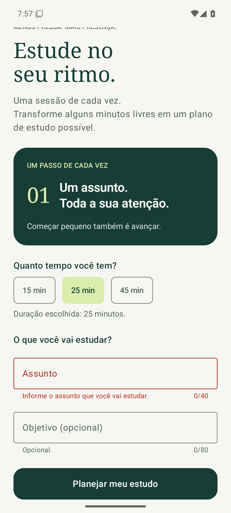
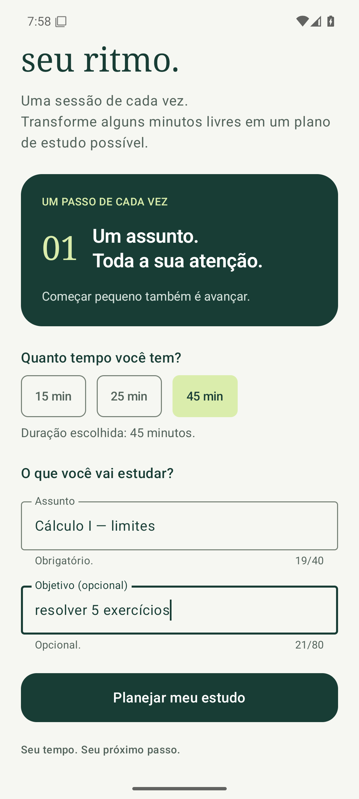
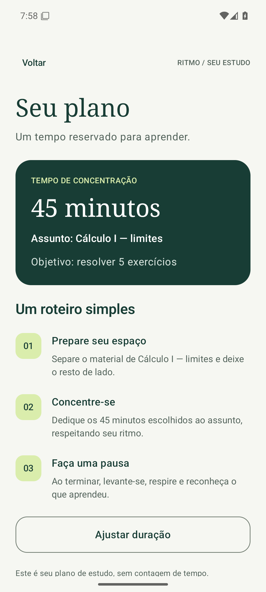

# SPRINT 04 — User Input, Forms & Validation

**Equipe 09:** Fernando Henrique Cobianchi e João Victor R. Peres.

## Objetivo e resultado

Antes de abrir o plano, o estudante agora informa **o que vai estudar** (obrigatório) e, se quiser, **o objetivo da sessão** (opcional). Dados inválidos mostram uma mensagem abaixo do campo e impedem a navegação; dados válidos abrem Seu plano com o assunto e o objetivo.

## Especificação

[SPEC-004](docs/specs/SPEC-004.md). A seção de rastreabilidade relaciona cada requisito ao código, critério de aceitação e evidência.

## Campos

| Campo | Situação | Formato aceito | Componente |
| --- | --- | --- | --- |
| Assunto | Obrigatório | Texto de 3 a 40 caracteres, sem contar espaços nas pontas | `OutlinedTextField` de uma linha |
| Objetivo | Opcional | Vazio ou texto de até 80 caracteres | `OutlinedTextField` |

A duração (15, 25 ou 45 min) continua sendo escolhida pelo seletor da sprint 2 e sempre tem um valor válido.

## Regras de validação e onde estão

| Regra | Condição de erro | Mensagem | Implementação |
| --- | --- | --- | --- |
| VR-01 | Assunto vazio ou só espaços | Informe o assunto que você vai estudar. | `model/SessionInput.kt` → `SessionRules.subjectError` |
| VR-02 | Assunto com menos de 3 caracteres | Use pelo menos 3 caracteres. | `SessionRules.subjectError` |
| VR-03 | Assunto com mais de 40 caracteres | Use no máximo 40 caracteres. | `SessionRules.subjectError` |
| VR-04 | Objetivo com mais de 80 caracteres | Use no máximo 80 caracteres. | `SessionRules.goalError` |

## Implementação

- **Estado do formulário:** `RitmoApp` guarda `subject`, `goal` e `showErrors` com `rememberSaveable`, ao lado de `selectedMinutes`. Os campos são controlados: exibem o valor desse estado e devolvem cada alteração por `onValueChange`.
- **Validação:** `SessionRules` concentra as regras, sem depender do Compose. O botão Planejar meu estudo chama `SessionRules.isValid(subject, goal)`.
- **Fluxo inválido:** `showErrors` passa a `true`. `SessionForm` calcula a mensagem de cada campo e a exibe em `supportingText`, com `isError = true` (contorno e texto em vermelho). O app não navega.
- **Fluxo válido:** o foco é limpo (o teclado fecha), o app navega para `plano`, e `PlanScreen` recebe o assunto e o objetivo já sem espaços nas pontas.
- As mensagens só aparecem depois da primeira tentativa, para não mostrar erro enquanto o estudante ainda está digitando; a partir daí, acompanham a correção.

## Validação

Compilação aprovada. **6 testes locais** das regras (`SessionRulesTest`) e **14 testes instrumentados** aprovados no emulador, sem falhas: 7 novos em `FormTest` e os 7 das sprints anteriores, ajustados para preencher o assunto antes de abrir o plano. [Resultados por critério](evidence/sprint-04/validation.md) e logs em `evidence/sprint-04/`.

**Cenário inválido:** com o assunto vazio, o toque em Planejar meu estudo mostrou “Informe o assunto que você vai estudar.” e a tela Seu plano não abriu. Os casos de 2 e 41 caracteres no assunto e 81 no objetivo foram verificados por `FormTest` e `SessionRulesTest`.

**Cenário válido:** 45 min, assunto “Cálculo I — limites” e objetivo “resolver 5 exercícios” abriram Seu plano com os três valores.

## Ajustes e limitações

Os testes de navegação da sprint 3 passaram a preencher o assunto antes de abrir o plano, já que agora ele é obrigatório. O assunto e o objetivo ficam apenas no estado da tela; salvar dados entre aberturas do app é tema da sprint 5.

## Uso de IA

| Item | Resposta |
| --- | --- |
| LLM/tool used | Claude (Claude Code) |
| Task supported by the LLM | Especificação, implementação do formulário e das regras, testes, automação da validação e documentação |
| Main suggestion received | Regras de validação fora da tela (`SessionRules`), testadas sem emulador; mensagens exibidas só após a primeira tentativa; fechar o teclado antes de navegar. |
| How the result was validated | Testes locais das regras, 14 testes instrumentados no emulador e capturas geradas pelos testes |

## Entrega

Branch: `team-09/sprint-04`, com destino à `main` do repositório da disciplina.

## Definition of Done

- [x] SPEC-004 completa.
- [x] Formulário implementado.
- [x] Validação implementada.
- [x] Cenários válido e inválido testados.
- [x] Evidências e uso de IA documentados.
- [ ] PR enviado.
