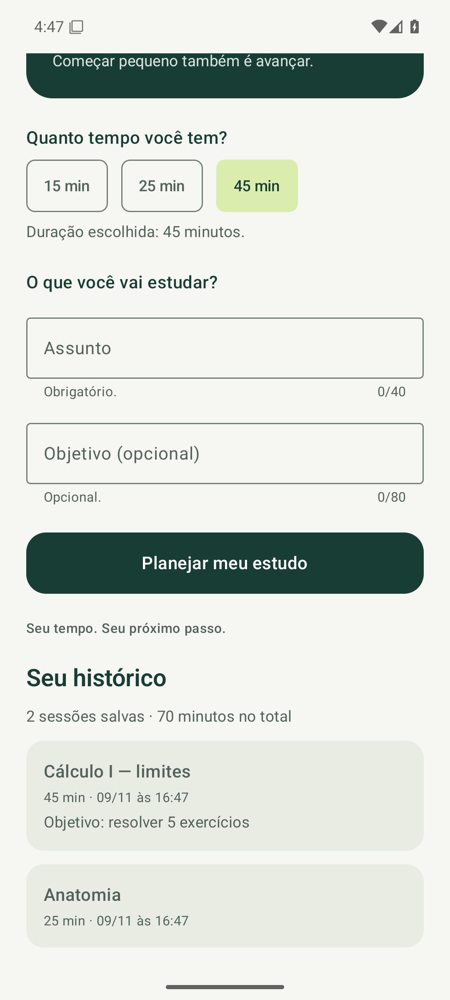
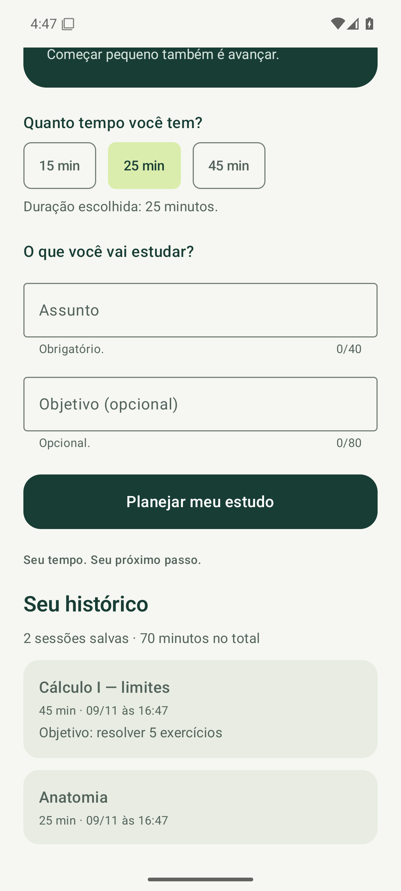

# SPRINT 05 — Local Persistence & Data

**Equipe 09:** Fernando Henrique Cobianchi e João Victor R. Peres.

## Objetivo e resultado

O estudante agora pode **salvar a sessão planejada** com o botão Salvar no histórico. A tela inicial mostra a seção **Seu histórico**, com as sessões mais recentes e os totais. Os dados ficam em um banco local e continuam lá depois de o app ser fechado e aberto de novo.

## Especificação

[SPEC-005](docs/specs/SPEC-005.md). A SPEC responde o que é salvo, por quê, quando é escrito e lido e como o usuário percebe o resultado.

## Mecanismo escolhido: Room

O histórico é uma lista de registros estruturados que cresce com o uso, com consultas de ordenação, limite e soma. Por isso escolhemos **Room**. DataStore serviria para valores pequenos, como uma preferência, e não para uma lista de sessões.

## Modelo de dados

Tabela `study_sessions`, entidade `StudySession` (`data/StudySession.kt`):

| Campo | Tipo | Observação |
| --- | --- | --- |
| `id` | Long | Chave primária gerada pelo Room |
| `subject` | String | Assunto, já validado pela SPEC-004 |
| `goal` | String? | Objetivo; `null` quando não informado |
| `minutes` | Int | 15, 25 ou 45 |
| `created_at` | Long | Momento do registro (ms desde 1970) |

## Organização do código

| Arquivo | Responsabilidade |
| --- | --- |
| `data/StudySession.kt` | Entidade (tabela) e `HistorySummary` (totais) |
| `data/SessionDao.kt` | `insert`, `observeRecent(limit)` e `observeSummary()`; o Room gera a implementação |
| `data/RitmoDatabase.kt` | Banco `ritmo.db`, com uma única instância por processo |
| `data/SessionRepository.kt` | Único ponto usado pela interface: `save(...)`, `recentSessions` e `summary` |
| `ui/HistorySection.kt` | Exibe os totais e as sessões |
| `ui/RitmoApp.kt` | Coleta os Flows com `collectAsState` e chama `save` em uma corrotina |

O código de persistência não fica no `onClick`: o botão só avisa o `RitmoApp`, que chama o repositório. Nenhum arquivo de `ui` usa o Room diretamente.

## Fluxo de gravação

1. Em Seu plano, o toque em **Salvar no histórico** desabilita o botão (evita gravar duas vezes) e chama `onSave`.
2. `RitmoApp` volta para a tela inicial e inicia uma corrotina com `repository.save(assunto, objetivo, minutos)`.
3. `SessionRepository` cria a `StudySession` (objetivo vazio vira `null`, com a hora atual) e chama `dao.insert`, uma função `suspend`: o Room grava fora da thread principal.
4. Depois de salvar, o formulário é limpo e aparece “Sessão salva no histórico.”.

## Fluxo de leitura

1. `MainActivity` cria `SessionRepository(RitmoDatabase.get(this).sessionDao())` e o entrega ao `RitmoApp`.
2. `RitmoApp` coleta `recentSessions` (5 mais recentes) e `summary` (quantidade e minutos) com `collectAsState`.
3. Os Flows do Room emitem de novo sempre que a tabela muda, e a seção Seu histórico é recomposta sozinha, tanto depois de salvar quanto na abertura do app.

## Validação

Compilação aprovada. **19 testes instrumentados** aprovados no emulador, sem falhas: 5 novos em `HistoryTest` e os 14 das sprints anteriores. Também passaram os 6 testes locais das regras do formulário. [Resultados por critério](evidence/sprint-05/validation.md) e logs em `evidence/sprint-05/`.

**Reinício:** o passo `createData` salvou “Anatomia” (25 min) e “Cálculo I — limites” (45 min, com objetivo) pela interface. Em seguida, o processo do app foi encerrado com `am force-stop`; o registro em [evidence-run.txt](evidence/sprint-05/evidence-run.txt) mostra que não havia processo do app antes do passo seguinte. O passo `restoreData` abriu o app do zero e encontrou as duas sessões e o total de 70 minutos.

## Ajustes e limitações

- `exportSchema = false`: esta é a primeira versão do banco e ainda não há migrações.
- Não é possível editar nem excluir sessões; isso ficou fora do escopo da sprint.
- A data e a hora usam o fuso configurado no aparelho.

## Uso de IA

| Item | Resposta |
| --- | --- |
| LLM/tool used | Claude (Claude Code) |
| Task supported by the LLM | Comparação Room × DataStore, modelo de dados, implementação, testes, automação da validação e documentação |
| Main suggestion received | Room para a lista de sessões; banco isolado atrás de `SessionRepository`; leitura por Flow com `collectAsState`; botão desabilitado após o primeiro toque. |
| How the result was validated | 19 testes instrumentados, testes locais e execução em dois processos separados (criar → encerrar → reabrir) com capturas |

## Entrega

Branch: `team-09/sprint-05`, com destino à `main` do repositório da disciplina.

## Definition of Done

- [x] SPEC-005 completa.
- [x] Persistência implementada.
- [x] Gravação, leitura e reinício validados.
- [x] Funcionalidades anteriores preservadas.
- [x] Evidências e uso de IA documentados.
- [ ] PR enviado.
