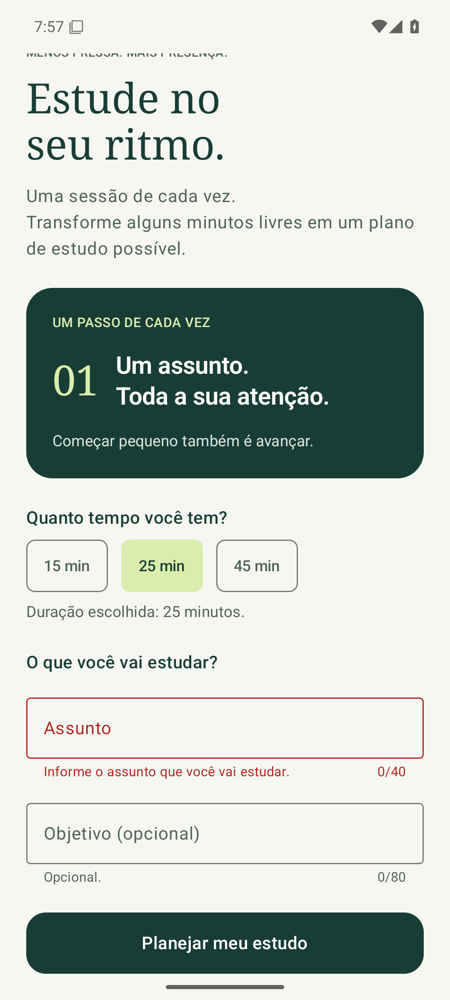
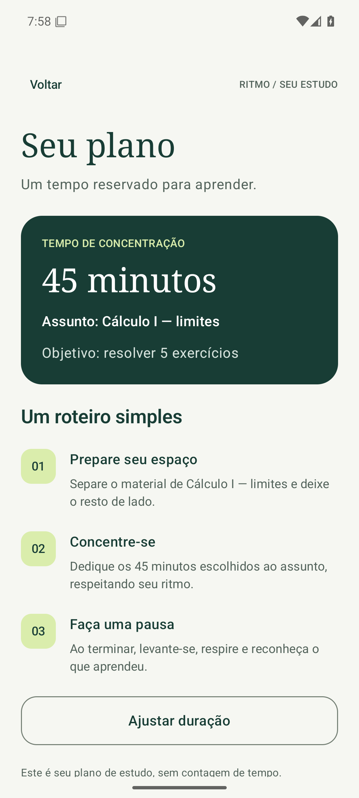

# SPEC-004 — Assunto e objetivo da sessão

> **Team:** Team 09<br>
> **Sprint:** Sprint 04<br>
> **Status:** Validada<br>
> **Related Sprint:** [SPRINT-04.md](../../SPRINT-04.md)

## 1. Context

**Problema:** Até a sprint 3, o plano só informava a duração. Sem um assunto definido, o estudante ainda precisa decidir o que estudar quando a sessão começa, o que favorece o adiamento.<br>
**Usuários:** Estudantes universitários, incluindo alunos da UNEMAT.<br>
**Contexto:** Antes de abrir o plano, o estudante informa o que vai estudar e, se quiser, o que pretende concluir.

## 2. Objective

Coletar o assunto (obrigatório) e o objetivo (opcional) da sessão, validar os valores com mensagens visíveis e só abrir o plano quando os dados forem válidos.

## 3. User Scenario

**Dado** que o estudante escolheu 45 min na tela inicial,<br>
**quando** toca em Planejar meu estudo sem informar o assunto,<br>
**então** vê a mensagem “Informe o assunto que você vai estudar.” e permanece na tela inicial.

**Dado** que o estudante informou “Cálculo I — limites” e o objetivo “resolver 5 exercícios”,<br>
**quando** toca em Planejar meu estudo,<br>
**então** vê Seu plano com 45 minutos, o assunto e o objetivo informados.

## 4. Functional Requirements

### FR-01 — Campos do formulário

Exibir na tela inicial, abaixo do seletor de duração, os campos **Assunto** (obrigatório) e **Objetivo (opcional)**, com contador de caracteres.

### FR-02 — Entrada controlada

Os valores digitados ficam no estado da interface (`RitmoApp`) e são preservados ao voltar do plano e ao recriar a Activity.

### FR-03 — Validação

Aplicar as regras da tabela abaixo ao tocar em Planejar meu estudo. Espaços no início e no fim não contam.

| Regra | Campo | Condição de erro | Mensagem exibida |
| --- | --- | --- | --- |
| VR-01 | Assunto | vazio ou só espaços | Informe o assunto que você vai estudar. |
| VR-02 | Assunto | menos de 3 caracteres | Use pelo menos 3 caracteres. |
| VR-03 | Assunto | mais de 40 caracteres | Use no máximo 40 caracteres. |
| VR-04 | Objetivo | mais de 80 caracteres (vazio é permitido) | Use no máximo 80 caracteres. |

### FR-04 — Feedback de erro

Com dados inválidos, o campo fica destacado em vermelho, a mensagem aparece abaixo dele e o app não navega. Depois da primeira tentativa, a mensagem é atualizada enquanto o estudante corrige o texto.

### FR-05 — Fluxo válido

Com dados válidos, o teclado é fechado, o app navega para Seu plano e exibe “Assunto: …” e, se informado, “Objetivo: …”, já sem espaços nas pontas.

## 5. Constraints

Kotlin, Jetpack Compose, Material 3, SDK mínimo 24 e compilação com SDK 35. Componentes usados: `OutlinedTextField` e `Button`. Sem dependências novas no app (apenas JUnit 4.13.2 para testes locais das regras). Sem rede e sem armazenamento permanente.

## 6. Out of Scope

Salvar o assunto entre aberturas do app, histórico de sessões, sugestões automáticas de assunto, cronômetro, login e APIs.

## 7. Acceptance Criteria

### AC-01

**Related requirement:** FR-01<br>
**Condition:** A tela inicial mostra os campos Assunto e Objetivo (opcional), com contadores 0/40 e 0/80.

### AC-02

**Related requirement:** FR-02<br>
**Condition:** O texto digitado aparece no campo e continua lá ao voltar do plano e após recriar a Activity.

### AC-03

**Related requirement:** FR-03, FR-04<br>
**Condition:** Assunto vazio, com 2 caracteres ou com 41 caracteres, e objetivo com 81 caracteres, mostram a mensagem correspondente e a tela Seu plano não abre.

### AC-04

**Related requirement:** FR-04<br>
**Condition:** Depois do erro, digitar um assunto válido remove a mensagem; tocar de novo abre o plano.

### AC-05

**Related requirement:** FR-05<br>
**Condition:** Assunto com 3 a 40 caracteres e objetivo vazio ou com até 80 caracteres abrem Seu plano com a duração, o assunto e o objetivo corretos.

### AC-06

**Related requirement:** sprints anteriores<br>
**Condition:** Seleção de duração e navegação da sprint 3 continuam funcionando.

## 8. Requirement Traceability

| Requirement | Implemented In | Acceptance Criterion | Evidence |
| --- | --- | --- | --- |
| FR-01 | `app/app/src/main/java/br/unemat/ritmo/ui/SessionForm.kt / SessionForm` e `WelcomeScreen.kt` | AC-01 | [valid-form.png](../../evidence/sprint-04/valid-form.png) |
| FR-02 | `app/app/src/main/java/br/unemat/ritmo/ui/RitmoApp.kt / subject, goal (rememberSaveable)` | AC-02 | `FormTest.typedValuesSurviveBackNavigationAndRecreation` |
| FR-03 | `app/app/src/main/java/br/unemat/ritmo/model/SessionInput.kt / SessionRules` | AC-03 | [invalid-input.png](../../evidence/sprint-04/invalid-input.png), `SessionRulesTest`, `FormTest` |
| FR-04 | `SessionForm.kt / isError, supportingText` e `RitmoApp.kt / showErrors` | AC-03, AC-04 | [invalid-input.png](../../evidence/sprint-04/invalid-input.png), `FormTest.errorDisappearsWhenInputIsCorrected` |
| FR-05 | `RitmoApp.kt / onPlan`, `WelcomeScreen.kt / clearFocus` e `PlanScreen.kt` | AC-05 | [valid-input.png](../../evidence/sprint-04/valid-input.png) |

## 9. Implementation Plan

**Componentes:** `SessionRules` (regras puras, sem Compose), `SessionForm` (dois `OutlinedTextField`), ajustes em `WelcomeScreen`, `RitmoApp` e `PlanScreen`.

```text
Tela inicial (campos vazios)
      ↓ estudante digita → onValueChange atualiza subject/goal no RitmoApp
Toque em Planejar meu estudo
      ↓ SessionRules.isValid(subject, goal)?
   não → showErrors = true → campos em vermelho com a mensagem, sem navegar
   sim → navigate("plano") → Seu plano com duração, assunto e objetivo
```

**Estado:** `subject`, `goal` e `showErrors` com `rememberSaveable` no `RitmoApp`, ao lado de `selectedMinutes`. As mensagens são calculadas a cada recomposição a partir do texto atual, por isso somem assim que o valor fica válido.

## 10. Validation Plan

1. Compilar e executar os testes locais (`testDebugUnitTest`) das regras VR-01 a VR-04, incluindo os limites 2/3, 40/41 e 80/81.
2. Executar os testes instrumentados no emulador (`connectedDebugAndroidTest`), incluindo os das sprints anteriores.
3. Tocar em Planejar meu estudo com o assunto vazio e capturar `invalid-input.png`.
4. Preencher dados válidos, capturar `valid-form.png`, abrir o plano e capturar `valid-input.png`.

## 11. Validation Results

Resultados registrados em [validation.md](../../evidence/sprint-04/validation.md).

| Acceptance Criterion | Result | Notes |
| --- | --- | --- |
| AC-01 | PASS | Campos e contadores visíveis em `valid-form.png`. |
| AC-02 | PASS | `FormTest.typedValuesSurviveBackNavigationAndRecreation`. |
| AC-03 | PASS | `FormTest` (vazio, curto, longo) e `SessionRulesTest`. |
| AC-04 | PASS | `FormTest.errorDisappearsWhenInputIsCorrected`. |
| AC-05 | PASS | `FormTest.validInputOpensPlanWithSubjectAndGoal` e `validInputWithoutGoalIsAccepted`. |
| AC-06 | PASS | `DurationTest`, `NavigationTest` e `WelcomeTest` aprovados. |

### Environment Used for Validation

Emulador Pixel 6, Android 15/API 35, x86_64, executado pelo GitHub Actions (Ubuntu, KVM). Gradle 8.11.1, JDK 21. Logs em `evidence/sprint-04/`.

## 12. Evidence




- [invalid-input.png](../../evidence/sprint-04/invalid-input.png)
- [valid-form.png](../../evidence/sprint-04/valid-form.png)
- [valid-input.png](../../evidence/sprint-04/valid-input.png)

## 13. AI-Assisted Development

**Ferramenta:** Claude (Claude Code).

Utilizamos o Claude na especificação, implementação, testes, automação da validação no GitHub Actions e documentação. A validação incluiu testes locais das regras, testes instrumentados no emulador e capturas de tela geradas pelos testes.

**Principais sugestões aceitas:** manter as regras em `SessionRules`, fora da tela, para testá-las sem emulador e explicá-las em um único lugar; e fechar o teclado ao tocar no botão, porque com o teclado aberto o Voltar do Android fecha o teclado em vez de voltar de tela.

## 14. Suggested Prompt for AI Assistance

Solicitação de apoio: revisar as regras VR-01 a VR-04 desta SPEC, gerar casos-limite para os testes e sugerir mensagens de erro mais claras, sem mudar a regra de negócio nem acrescentar funcionalidades de outras sprints.

## 15. Deliverables

Projeto Android atualizado, esta SPEC, SPRINT-04.md, `invalid-input.png`, `valid-input.png` e resultados em `evidence/sprint-04/`.

## 16. Specification Status

- [x] Contexto, objetivo, FRs, regras, limites e critérios mensuráveis definidos.
- [x] Plano de implementação e de validação definidos.
- [x] Implementação validada e evidências registradas.
