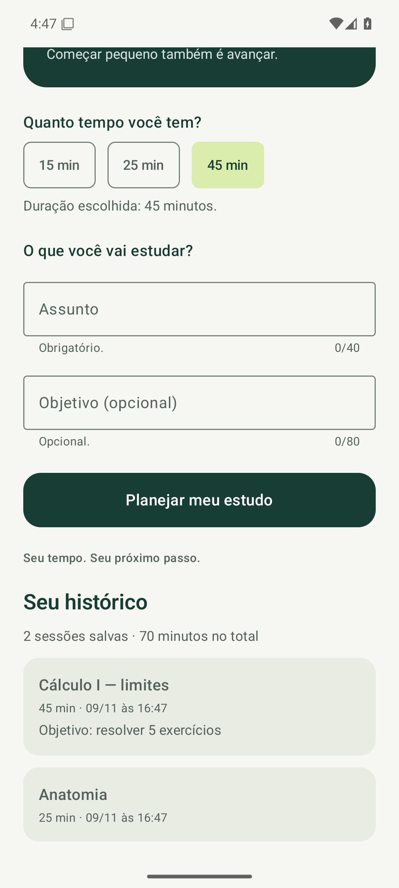
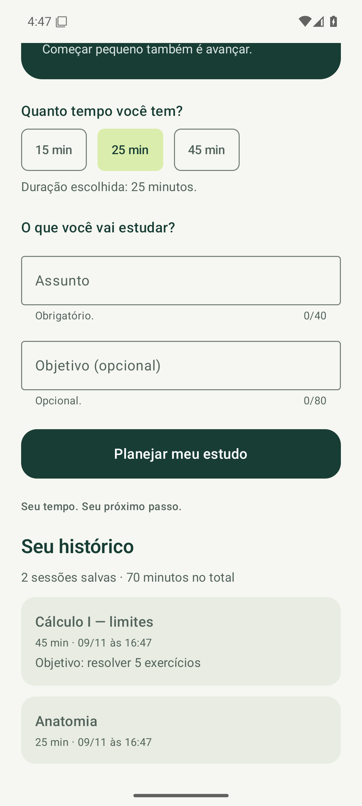

# SPEC-005 — Histórico de sessões salvo no aparelho

> **Team:** Team 09<br>
> **Sprint:** Sprint 05<br>
> **Status:** Validada<br>
> **Related Sprint:** [SPRINT-05.md](../../SPRINT-05.md)

## 1. Context

**Problema:** Até a sprint 4, assunto, objetivo e duração existiam apenas enquanto o app estava aberto. Ao fechar o app, o estudante perdia o registro do que já tinha planejado e estudado.<br>
**Usuários:** Estudantes universitários, incluindo alunos da UNEMAT.<br>
**Contexto:** Ao terminar de consultar o plano, o estudante guarda a sessão para acompanhar, nas próximas aberturas, o que estudou e quanto tempo dedicou.

## 2. Objective

Salvar cada sessão confirmada em um banco local e exibir, na tela inicial, o histórico e os totais, que continuam disponíveis depois de o app ser fechado e aberto de novo.

## 3. User Scenario

**Dado** que o estudante abriu o plano de 45 minutos para “Cálculo I — limites”,<br>
**quando** toca em Salvar no histórico, fecha o app e o abre de novo,<br>
**então** vê em Seu histórico a sessão “Cálculo I — limites”, com 45 min, data e hora, e os totais atualizados.

## 4. What Must Persist

| Pergunta | Resposta |
| --- | --- |
| O que é salvo | Cada sessão: assunto, objetivo (opcional), duração em minutos e momento do registro. |
| Por que precisa persistir | O histórico só tem utilidade se continuar existindo entre as aberturas do app. |
| Quando é escrito | Ao tocar em Salvar no histórico, na tela Seu plano. |
| Quando é lido | Continuamente, enquanto a tela inicial está aberta; o banco avisa a interface quando a tabela muda. |
| Como o usuário percebe | Seção Seu histórico na tela inicial, com totais e as 5 sessões mais recentes, e a confirmação “Sessão salva no histórico.” |

## 5. Persistence Choice

**Room.** O histórico é uma lista de registros estruturados que cresce com o uso, com campos tipados e consultas de ordenação, limite e soma. Esse é o caso indicado para Room pela disciplina. DataStore foi descartado porque serve a valores pequenos de preferência, não a listas de registros.

## 6. Data Model

Tabela `study_sessions` (entidade `StudySession`):

| Campo | Tipo | Obrigatório | Origem |
| --- | --- | --- | --- |
| `id` | Long, chave primária gerada | sim | Room |
| `subject` | String | sim | campo Assunto (já validado pela SPEC-004) |
| `goal` | String? | não (null quando vazio) | campo Objetivo |
| `minutes` | Int | sim | seletor de duração (15, 25 ou 45) |
| `created_at` | Long (ms desde 1970) | sim | relógio do aparelho no momento do registro |

**Operações (`SessionDao`):** `insert(session)`; `observeRecent(limit)`, com as sessões mais recentes primeiro; `observeSummary()`, com a quantidade e a soma dos minutos.

## 7. Functional Requirements

### FR-01 — Salvar sessão

Na tela Seu plano, o botão Salvar no histórico grava a sessão com assunto, objetivo, duração e momento atual, volta para a tela inicial, limpa o formulário e mostra “Sessão salva no histórico.”.

### FR-02 — Evitar duplicidade

Toques repetidos no botão gravam apenas uma sessão.

### FR-03 — Ler e exibir

A tela inicial mostra a seção Seu histórico com “N sessão(ões) salva(s) · M minutos no total” e as 5 sessões mais recentes (assunto, duração, data e hora e, se houver, o objetivo). Sem sessões, mostra uma orientação.

### FR-04 — Persistir após reinício

As sessões salvas continuam aparecendo depois de o processo do app ser encerrado e o app ser aberto novamente.

### FR-05 — Separação entre interface e dados

A interface usa apenas `SessionRepository`; o acesso ao Room fica no pacote `data`.

## 8. Constraints

Kotlin, Jetpack Compose, Material 3, SDK mínimo 24 e compilação com SDK 35. Room 2.7.1 com KSP 2.1.20-1.0.32. Banco apenas local, sem rede. O formulário e as regras da SPEC-004 não mudam.

## 9. Out of Scope

Editar ou excluir sessões, tela separada de histórico, filtros, sincronização em nuvem, login, cronômetro e migrações de banco (esta é a versão 1 do esquema).

## 10. Acceptance Criteria

### AC-01

**Related requirement:** FR-01<br>
**Condition:** Após Salvar no histórico, a tela inicial mostra a sessão com assunto, duração e objetivo, e o formulário volta vazio.

### AC-02

**Related requirement:** FR-02<br>
**Condition:** Um toque duplo em Salvar no histórico resulta em “1 sessão salva”.

### AC-03

**Related requirement:** FR-03<br>
**Condition:** Com 6 sessões no banco, a tela mostra “6 sessões salvas · 90 minutos no total” e só as 5 mais recentes; sem sessões, mostra a orientação.

### AC-04

**Related requirement:** FR-04<br>
**Condition:** Duas sessões criadas antes de encerrar o processo do app aparecem com os mesmos dados e totais na abertura seguinte.

### AC-05

**Related requirement:** FR-05<br>
**Condition:** Nenhum arquivo do pacote `ui` importa classes do Room; o salvamento usa `SessionRepository.save` dentro de uma corrotina.

### AC-06

**Related requirement:** sprints anteriores<br>
**Condition:** Duração, navegação e validação do formulário continuam funcionando.

## 11. Requirement Traceability

| Requirement | Implemented In | Acceptance Criterion | Evidence |
| --- | --- | --- | --- |
| FR-01 | `ui/PlanScreen.kt / Salvar no histórico`, `ui/RitmoApp.kt / onSave`, `data/SessionRepository.kt / save` | AC-01 | [data-created.png](../../evidence/sprint-05/data-created.png), `HistoryTest.savingAddsSessionToHistoryAndClearsTheForm` |
| FR-02 | `ui/PlanScreen.kt / saved` | AC-02 | `HistoryTest.doubleTapOnSaveStoresOneSession` |
| FR-03 | `data/SessionDao.kt / observeRecent, observeSummary`, `ui/HistorySection.kt` | AC-03 | `HistoryTest.homeReadsDatabaseNewestFirstLimitedToFive`, `emptyHistoryShowsHint` |
| FR-04 | `data/RitmoDatabase.kt / ritmo.db` | AC-04 | [data-restored.png](../../evidence/sprint-05/data-restored.png), [evidence-run.txt](../../evidence/sprint-05/evidence-run.txt) |
| FR-05 | pacote `data` e `MainActivity.kt` | AC-05 | Revisão do código (seção Implementação do relatório) |

## 12. Implementation Plan

```text
Seu plano → toque em Salvar no histórico
      ↓ RitmoApp.onSave: volta para a tela inicial e inicia uma corrotina
SessionRepository.save(assunto, objetivo, minutos)
      ↓ SessionDao.insert (Room grava em ritmo.db, fora da thread principal)
A tabela muda → os Flows observeRecent/observeSummary emitem de novo
      ↓ collectAsState no RitmoApp
Seção Seu histórico é recomposta com os novos dados
```

Na abertura do app, `MainActivity` cria o `SessionRepository` com o DAO do banco único (`RitmoDatabase.get`). O `RitmoApp` coleta os dois Flows; a primeira emissão já traz o que estava salvo.

## 13. Validation Plan

1. Compilar e executar os testes locais e instrumentados, incluindo os das sprints anteriores.
2. Pelo app, salvar “Anatomia” (25 min) e “Cálculo I — limites” (45 min, com objetivo) e capturar `data-created.png`.
3. Encerrar o processo do app (`am force-stop`), confirmar que não há processo em execução e abrir o app de novo.
4. Conferir as duas sessões e os totais e capturar `data-restored.png`.

## 14. Validation Results

Resultados registrados em [validation.md](../../evidence/sprint-05/validation.md).

| Acceptance Criterion | Result | Notes |
| --- | --- | --- |
| AC-01 | PASS | `HistoryTest.savingAddsSessionToHistoryAndClearsTheForm` e `data-created.png`. |
| AC-02 | PASS | `HistoryTest.doubleTapOnSaveStoresOneSession`. |
| AC-03 | PASS | `HistoryTest.homeReadsDatabaseNewestFirstLimitedToFive` e `emptyHistoryShowsHint`. |
| AC-04 | PASS | Passos de evidência em processos separados; `data-restored.png`. |
| AC-05 | PASS | Imports do pacote `ui` revisados. |
| AC-06 | PASS | `WelcomeTest`, `DurationTest`, `NavigationTest` e `FormTest` aprovados. |

### Environment Used for Validation

Emulador Pixel 6, Android 15/API 35, x86_64, executado pelo GitHub Actions (Ubuntu, KVM). Gradle 8.11.1, JDK 21. Logs em `evidence/sprint-05/`.

## 15. Evidence




## 16. AI-Assisted Development

**Ferramenta:** Claude (Claude Code).

Utilizamos o Claude na comparação entre Room e DataStore, no modelo de dados, na implementação, nos testes, na automação da validação e na documentação. A validação incluiu testes instrumentados e a execução em dois processos separados para comprovar a leitura após o reinício.

**Principais sugestões aceitas:** usar Room por se tratar de uma lista de registros; isolar o banco atrás de `SessionRepository`; desabilitar o botão depois do primeiro toque para evitar sessões duplicadas.

## 17. Deliverables

Projeto Android atualizado, esta SPEC, SPRINT-05.md, `data-created.png`, `data-restored.png` e resultados em `evidence/sprint-05/`.

## 18. Specification Status

- [x] Dados, motivo, escrita, leitura e resultado visível definidos.
- [x] Modelo de dados e operações definidos.
- [x] Plano de implementação e de validação definidos.
- [x] Implementação validada e evidências registradas.
