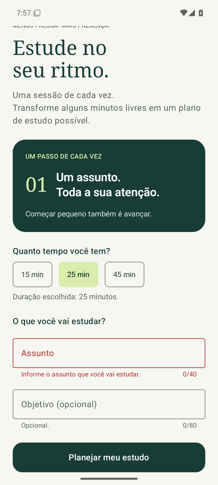
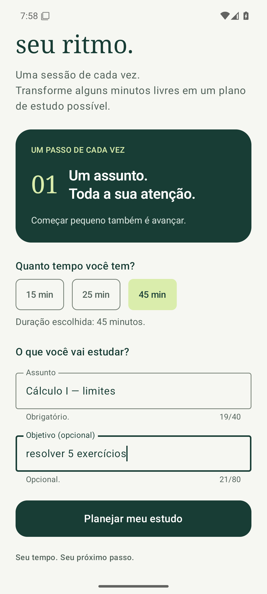
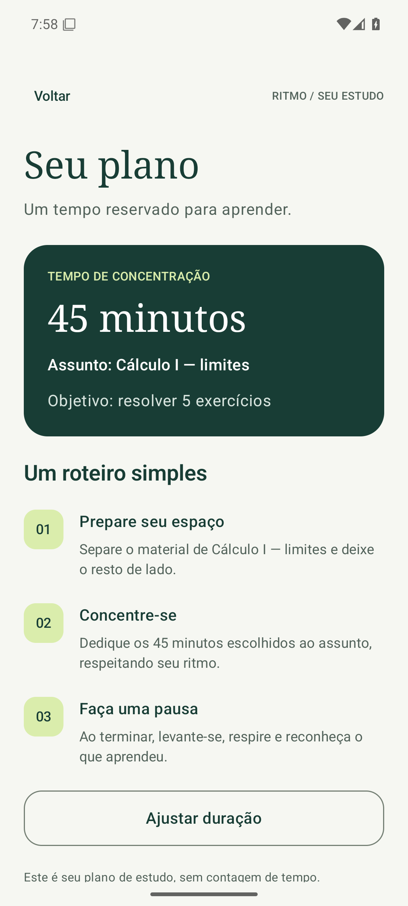

# Validação — Sprint 04

Validação realizada em 09/11/2026, em um emulador Pixel 6 com Android 15/API 35 (x86_64), executado pelo GitHub Actions (Ubuntu, KVM). As capturas foram geradas pelos próprios testes (`Sprint04Evidence`), cada uma em um processo novo do app ([evidence-run.txt](evidence-run.txt)).

Comandos, a partir de `app/`:

- `gradlew assembleDebug testDebugUnitTest lintDebug --console=plain`: **BUILD SUCCESSFUL** ([build-unit-lint.txt](build-unit-lint.txt))
- `gradlew connectedDebugAndroidTest --console=plain`: **BUILD SUCCESSFUL** ([instrumented-tests.txt](instrumented-tests.txt))

| Conjunto | Resultado |
| --- | --- |
| Testes locais (`SessionRulesTest`) | 6 aprovados, 0 falhas ([unit-tests.xml](unit-tests.xml)) |
| Testes instrumentados | 14 aprovados, 0 falhas; 2 classes de evidência ignoradas nessa execução, conforme previsto ([instrumented-tests.xml](instrumented-tests.xml)) |
| Lint | 0 erros e 10 avisos ([lint.txt](lint.txt)) |

| Critério da SPEC | Resultado | Como foi verificado |
| --- | --- | --- |
| AC-01 | PASS | Campos e contadores 0/40 e 0/80 visíveis em `invalid-input.png`; preenchidos em `valid-form.png`. |
| AC-02 | PASS | `FormTest.typedValuesSurviveBackNavigationAndRecreation`. |
| AC-03 | PASS | `FormTest.emptySubjectShowsErrorAndStaysOnHome`, `shortSubjectShowsMinimumError`, `longSubjectAndGoalShowMaximumErrors`; limites 2/3, 40/41 e 80/81 em `SessionRulesTest`. |
| AC-04 | PASS | `FormTest.errorDisappearsWhenInputIsCorrected`. |
| AC-05 | PASS | `FormTest.validInputOpensPlanWithSubjectAndGoal` (espaços nas pontas removidos) e `validInputWithoutGoalIsAccepted`. |
| AC-06 | PASS | `WelcomeTest`, `DurationTest` (2) e `NavigationTest` (4) aprovados. |

## Observações

- Lint: nove avisos são os mesmos da sprint 3 (versões de dependências e `allowBackup`). O aviso novo informa que o SDK 35 não é mais o mais recente; o alvo foi mantido para não mudar o ambiente no meio da disciplina.
- Os testes de navegação passaram a preencher o assunto antes de abrir o plano, já que agora ele é obrigatório.

## Capturas

**Inválido:** toque em Planejar meu estudo com o assunto vazio.

**Válido:** 45 min, “Cálculo I — limites” e “resolver 5 exercícios”, antes e depois do toque.

