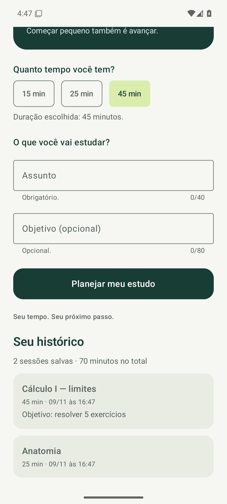
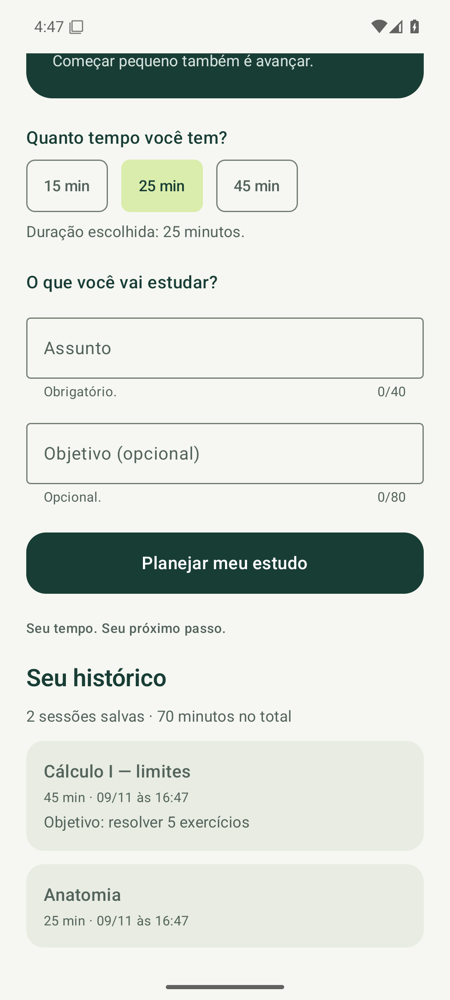

# Validação — Sprint 05

Validação realizada em 09/11/2026, em um emulador Pixel 6 com Android 15/API 35 (x86_64), executado pelo GitHub Actions (Ubuntu, KVM). Para as capturas, o fuso do emulador foi ajustado para America/Cuiaba ([device-date.txt](device-date.txt)).

Comandos, a partir de `app/`:

- `gradlew assembleDebug testDebugUnitTest lintDebug --console=plain`: **BUILD SUCCESSFUL** ([build-unit-lint.txt](build-unit-lint.txt))
- `gradlew connectedDebugAndroidTest --console=plain`: **BUILD SUCCESSFUL** ([instrumented-tests.txt](instrumented-tests.txt))

| Conjunto | Resultado |
| --- | --- |
| Testes locais (`SessionRulesTest`) | 6 aprovados, 0 falhas ([unit-tests.xml](unit-tests.xml)) |
| Testes instrumentados | 19 aprovados, 0 falhas; 4 testes de evidência ignorados nessa execução, conforme previsto ([instrumented-tests.xml](instrumented-tests.xml)) |
| Lint | 0 erros e 13 avisos ([lint.txt](lint.txt)) |

## Reinício do app

Cada passo de evidência roda em um processo novo. Antes de cada passo, o script executa `am force-stop br.unemat.ritmo` e registra o processo do app ([evidence-run.txt](evidence-run.txt)):

```text
== Sprint05Evidence#createData
processo do app antes do passo: nenhum (app fechado)
OK (1 test)
== Sprint05Evidence#restoreData
processo do app antes do passo: nenhum (app fechado)
OK (1 test)
```

`createData` esvazia o banco e salva duas sessões pela interface. `restoreData` não grava nada: abre o app do zero e só lê. As duas sessões e o total de 70 minutos aparecem, enquanto a duração selecionada volta ao padrão de 25 min (estado de tela, que não é persistido).

| Critério da SPEC | Resultado | Como foi verificado |
| --- | --- | --- |
| AC-01 | PASS | `HistoryTest.savingAddsSessionToHistoryAndClearsTheForm`; `data-created.png`. |
| AC-02 | PASS | `HistoryTest.doubleTapOnSaveStoresOneSession`. |
| AC-03 | PASS | `HistoryTest.homeReadsDatabaseNewestFirstLimitedToFive` e `emptyHistoryShowsHint`. |
| AC-04 | PASS | `createData` → processo encerrado → `restoreData`; `data-restored.png`. |
| AC-05 | PASS | Nenhum arquivo de `ui/` importa `androidx.room`; o salvamento usa `SessionRepository.save` em `scope.launch`. |
| AC-06 | PASS | `WelcomeTest`, `DurationTest`, `NavigationTest` e `FormTest` aprovados (14 testes). |

## Observações

- Lint: os 10 avisos da sprint 4 continuam; os 3 novos informam que existe Room 2.8.5. A versão 2.7.1 foi mantida por ser compatível com o Kotlin 2.1.20 já usado no projeto.
- Na primeira tentativa, o fuso foi alterado antes dos testes instrumentados, e alguns testes de formulário falharam por perda de foco da janela. Com a alteração feita só antes das capturas, a execução completa foi aprovada.

## Capturas



